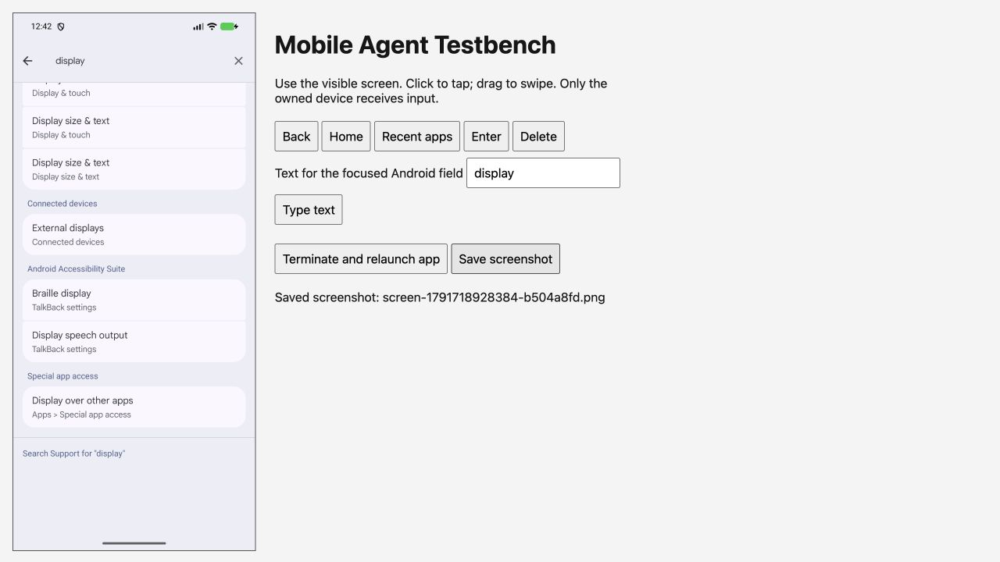

# Mobile Agent Testbench

A browser-based mobile testing console for AI agents.

An agent or a human opens a local browser page, sees the native device screen,
and uses clicks, drags and visible controls to operate the app. The console
records attempted actions, their outcomes and saved screenshots.



**Current platform: Android.** Hosts: macOS and Linux. iOS support is outside
this first release. There is no hosted service or account requirement.

## Start

Install Node.js 22 or later and Android SDK platform-tools. Put `adb` on your
PATH and connect an Android device with USB debugging authorized, or start an
Android emulator. The app to test must already be installed.

```sh
npm install --save-dev github:samwiskow/mobile-agent-testbench#v0.1.0
npx mobile-agent-testbench --app org.example.app --device emulator-5554
```

Open the printed `http://127.0.0.1:...` URL in your browser or your agent's
browser tool. Click the screen to tap and drag to swipe. Use the controls for
text, Back, Home, recent apps, restart and screenshot capture. Press Ctrl-C in
the terminal to stop the console and release the device.

Omit `--device` only when exactly one authorized device is connected. Select a
results directory with `--output ./test-evidence/run-1`; use a new directory
for each run. The default is a unique directory under `.mobile-agent-testbench/`.

## Temporary emulators

```sh
npx mobile-agent-testbench --app org.example.app --avd Pixel_7a
```

The AVD must already exist. Put `emulator` on PATH or set `ANDROID_HOME` or
`ANDROID_SDK_ROOT`. The tool reserves an unused emulator serial and port pair,
starts a headless read-only instance, and stops it on exit. Its data is
discarded. Existing devices and emulators are left running. Install your app
inside an owned session before opening the console:

```sh
npx mobile-agent-testbench session --avd Pixel_7a -- sh
adb -s "$ANDROID_SERIAL" install /path/to/app.apk
npx mobile-agent-testbench --app org.example.app
# Exit the shell after closing the console to stop the temporary emulator.
```

## Device ownership

```sh
npx mobile-agent-testbench session --device emulator-5554 -- sh
```

Keep all install, UI, screenshot and cleanup commands inside that session.
Always pass `-s "$ANDROID_SERIAL"` to ADB. Nested tool commands reuse the owned
session and cannot switch to another device. Separate devices can run at the
same time; commands targeting the same device wait.

Locks are shared across repositories and package installations for the same OS
user. They are cooperative: raw ADB commands and unrelated tools can bypass
them. A forced kill can leave an abandoned lock under
`/tmp/mobile-agent-testbench-<uid>-<encoded-serial>/owner.json`. Confirm that its
owner and child processes have stopped before removing it. Never remove a live
owner's lock to obtain a device.

## Evidence

- `run.json`: selected device, app package and session start/stop times.
- `actions.jsonl`: action attempts and successes/failures, matched by action ID.
- `screen-*.png`: screenshots saved with the console's capture button.

An ADB command completing does not prove the app did the expected thing. The
agent must inspect the resulting screen, check the outcome and retain failed
attempts. This tool supplies device control and evidence; it does not decide
whether a test passed. Text entered into the console is included in the action
record. Use test data and review evidence before sharing it.

## Project integration

Use the package as a development dependency. It is not part of the Android app.
The JavaScript exports are:

| Import | Exports |
| --- | --- |
| `@samwiskow/mobile-agent-testbench` | `startComputerConsole` |
| `@samwiskow/mobile-agent-testbench/session` | `withAndroidSession`, `requireAndroidSession`, `resolveDevice`, `runCommand`, `startCommand`, `sessionDirectory` |
| `@samwiskow/mobile-agent-testbench/session-cli` | `runSession` |
| `@samwiskow/mobile-agent-testbench/emulator` | `withNewEmulator` |

`startComputerConsole({ adb, results, appId, setupActions? })` returns
`{ url, stop }`. The `adb(...args)` function must target the owned serial and
return a Buffer for screenshots. The caller owns the session and must call
`stop()` before releasing it. Restart discovers the selected app's launcher
activity through Android.

Keep application-specific fixtures and source checks in the consuming project.
Register optional setup buttons as `{ id, label, run: async () => ... }` entries
in `setupActions`. The callbacks run in the host process and their failures are
recorded. Register destructive setup only for dedicated test installations.
The standalone console does not expose fixture or data-reset controls.

`withAndroidSession(action, { serial, signal? })` passes an environment object
to `action`. Pass this to child processes with `{ ...process.env, ...session }`.
`requireAndroidSession(env?)` verifies that the current token and serial match
the live owner. `runSession(args, { env?, withSession? })` implements the session
command. A project can supply `withSession` to preserve an existing lock during
migration; temporary emulator allocation uses that same reservation function.

## Limits

- Screenshots refresh about every 1.5 seconds; this is not video streaming.
- Text input accepts up to 200 ASCII letters, numbers, spaces and `.,_@+-`.
- Gestures cover single taps and straight swipes. There is no multi-touch input.
- The console binds only to loopback, uses a random session path and rejects
  cross-origin action requests. Keep the URL private; remote access is unsupported.
- Device disconnection and forced process termination can interrupt cleanup.

## Development

```sh
npm test
npm pack --dry-run
```

Tests exercise the HTTP interface, browser input, CLI process, device ownership,
emulator allocation and cleanup. ADB and emulator processes are replaced only
at the operating-system boundary. Native acceptance still needs a real Android
device or emulator; passing these tests is not physical-device evidence.

## Licence

Apache-2.0. See [LICENSE](LICENSE) and [NOTICE](NOTICE).
